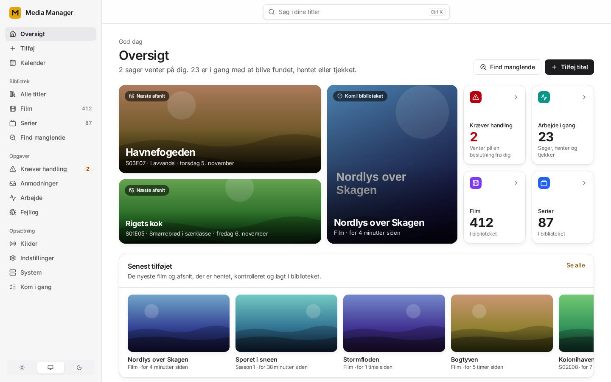
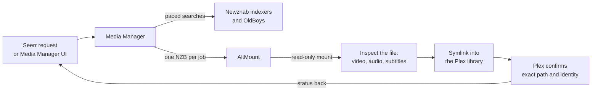
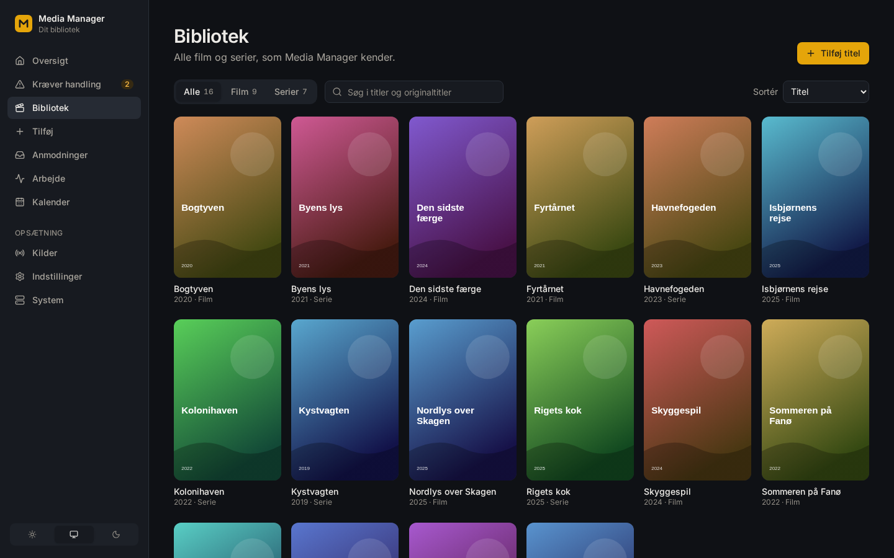
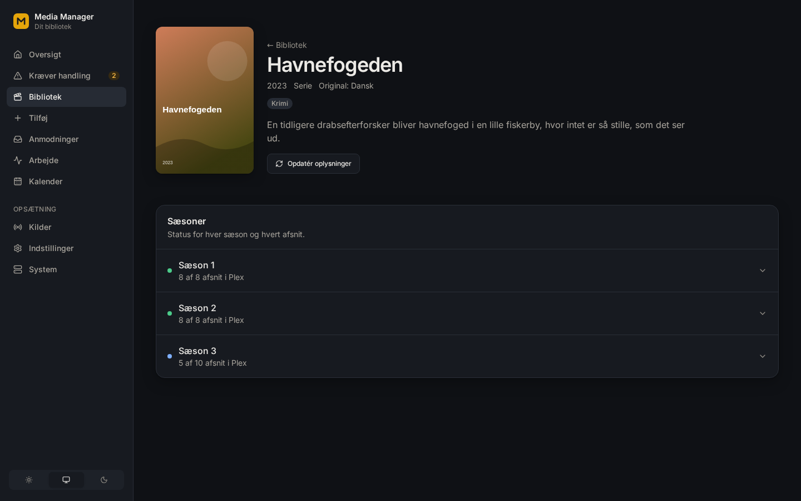
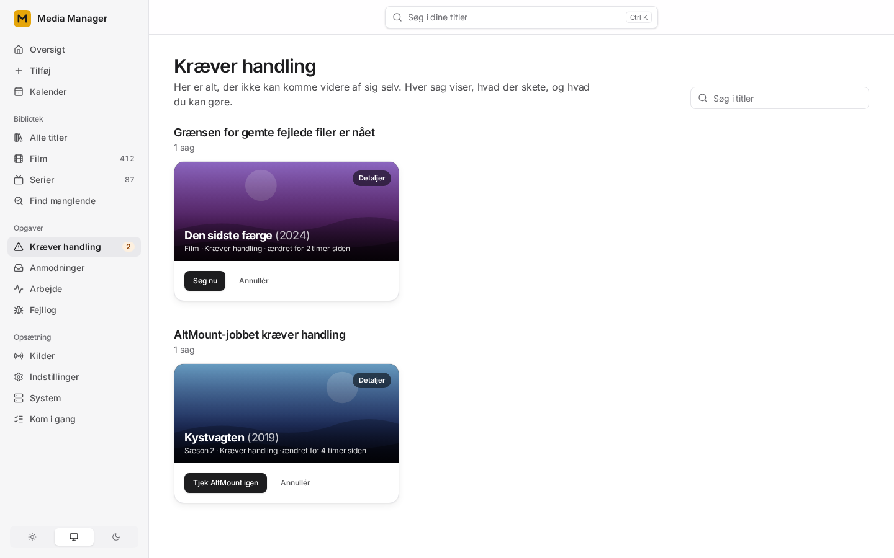
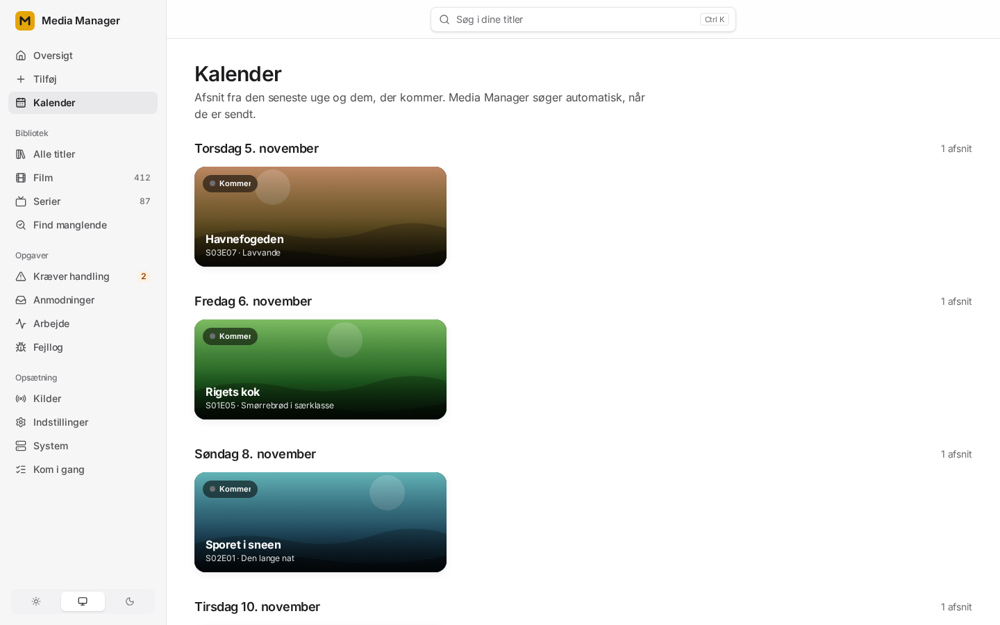

# Media Manager

**Self-hosted movie and TV automation for Usenet: from request to Plex, with every file checked before it gets there.**

Media Manager takes a movie or series request from [Seerr](https://github.com/seerr-team/seerr) or from its own web UI, searches your Newznab indexers, chooses a release on recorded evidence, streams it through [AltMount](https://github.com/javi11/altmount), inspects the actual file, and only then links it into your Plex library and confirms that Plex sees exactly that file.

It replaces Radarr and Sonarr in this setup: Seerr talks to Media Manager through the same API, so there is one place that decides what is downloaded and why. The web UI is in Danish.

## Highlights

- **Verified before it reaches Plex.** Downloaded output is probed for video, audio and subtitle tracks. Required languages, such as Danish subtitles or Danish audio for children's libraries, must be present in the file itself; a release name is never taken as proof.
- **Never replaces what works.** An upgrade becomes current only after Plex confirms the new file at the exact path and identity. AltMount output is read-only, and failed downloads are kept for review instead of being deleted.
- **Season packs done properly.** A pack is one download job, and publication waits until every expected episode maps to exactly one file.
- **Sparing with indexer calls.** Missing episodes of a season share one season search, a failed download picks the next release from the search that just found it, date-named shows are searched by series ID and air date, and each indexer's newest uploads (read from where the last read stopped, also across restarts) bring a waiting title's search forward instead of searching blindly. Each indexer still gets one request at a time, persisted pacing, rolling daily query and download budgets, and `Retry-After` handling.
- **Learns where the Danish is.** Media Manager keeps each release group's measured Danish record and tries groups that usually carry Danish first; groups that almost never do are held with the reason shown, so fewer downloads are wasted.
- **Shows what is missing.** *Find manglende* lists the seasons of your series that are neither followed nor in Plex and the films without a file, and you choose what to fetch.
- **Explains itself.** Every search, candidate, verdict and attempt is stored, so the UI can show why a title is waiting and which owner actions are safe right now.
- **Repairs itself.** Files that AltMount reports as corrupted, or has removed because their Usenet articles are gone, are re-acquired automatically and swapped in after Plex confirms the replacement.
- **Danish sources built in.** Includes a native client for the OldBoys Danish-original provider alongside standard Newznab indexers.
- **Streaming API.** A scoped player token lets a Stremio or Nuvio addon search for and play releases. The addon never holds indexer or AltMount credentials.
- **Built for automation.** It has a single route table, a generated [OpenAPI document](docs/reference/openapi.json) and an MCP server for AI agents.

## How it works

Each step is a durable, retryable event in PostgreSQL, so a restart or an outage resumes where it stopped instead of starting over. [docs/architecture/workflows.md](docs/architecture/workflows.md) describes the full lifecycle, including rounds, upgrades, adoption of existing files and recycling.

## Screenshots

| Library | Title and season progress |
| --- | --- |
|  |  |
| **Needs you** | **Calendar** |
|  |  |

The UI has light and dark themes ([dark overview](docs/images/overview-dark.png)) and works on phones. The screenshots use invented demo data and locally drawn artwork; `npm run build && npm run screenshots` in `web/` regenerates them.

## Getting started

You need:

- a Linux `amd64` host with Docker Engine and Compose v2.24 or later;
- [AltMount](https://github.com/javi11/altmount), Plex and at least one Newznab indexer;
- [Cosmos Cloud](https://cosmos-cloud.io) as the public edge for TLS and owner sign-in;
- Seerr, which is optional.

There are three ways to install:

1. **Cosmos market.** Add `https://raw.githubusercontent.com/Media-manager52/Media-manager/main/deploy/cosmos/index.json` as a market source and install *Media Manager*. The wizard creates the services and routes.
2. **From source with the setup script.** `./scripts/setup-cosmos.sh` writes the local secrets, creates the shared Docker network, builds the stack and prints the three Cosmos routes to add. Follow [docs/getting-started.md](docs/getting-started.md).
3. **Published images.** Pin an immutable API/UI image pair with `compose.release.yaml`; see [docs/operations/install-release.md](docs/operations/install-release.md).

After installing, connect AltMount, Plex and your indexers, create a library root and a quality profile, and add a title. [Getting started](docs/getting-started.md) walks through each step. [Manual installation](docs/operations/manual-install.md) covers the mount contract, the integration settings and the Seerr setup without Radarr or Sonarr.

## Documentation

| Topic | Where |
| --- | --- |
| Install and first run | [Getting started](docs/getting-started.md) · [Release images](docs/operations/install-release.md) · [Manual installation](docs/operations/manual-install.md) |
| Running it day to day | [Operations runbook](docs/operations/runbook.md) · [OldBoys](docs/operations/oldboys.md) · [AI agents and automation](docs/operations/ai-agents.md) |
| How it is built | [Architecture overview](docs/architecture/overview.md) · [HTTP API](docs/architecture/api.md) · [Database](docs/architecture/database.md) · [Web UI](docs/architecture/frontend.md) |
| Guarantees | [System invariants](docs/invariants.md) · [Acquisition and publication safety rules](docs/architecture/acquisition-safety.md) |
| Everything else | [Documentation index](docs/README.md) · [Changelog](CHANGELOG.md) |

## Tech stack

- **API and workers:** Go 1.27 with a durable outbox and four direct Go dependencies.
- **Database:** PostgreSQL 18, with forward-only transactional migrations that run at startup.
- **Web UI:** React 19, TypeScript, Vite and Tailwind CSS, served by a dependency-free Node server with a strict Content Security Policy.
- **Edge:** Cosmos Cloud. It injects the owner token server-side, so the token never reaches browser JavaScript.
- **Deployment:** Docker Compose, with images published to GHCR for every verified `main` commit.

## Project status

Media Manager is in **beta**. It runs one owner's production library every day and is developed against that real workload. The supported path is deliberately narrow: Seerr, Media Manager, Newznab, AltMount and Plex on Linux `amd64`. Each release note lists its known limitations and what has and has not been verified.

## Contributing and security

Read [CONTRIBUTING.md](CONTRIBUTING.md) first; [AGENTS.md](AGENTS.md) is the short version for AI coding agents. Please report vulnerabilities privately as described in [SECURITY.md](SECURITY.md).

## License

Media Manager is licensed under the [GNU Affero General Public License v3.0 only](LICENSE) (`AGPL-3.0-only`). If you run a modified version as a network service, you must offer its source to the people who use it. Third-party components keep their own licenses; see [THIRD_PARTY_NOTICES.md](THIRD_PARTY_NOTICES.md).

This product uses the TMDB API but is not endorsed or certified by TMDB.
