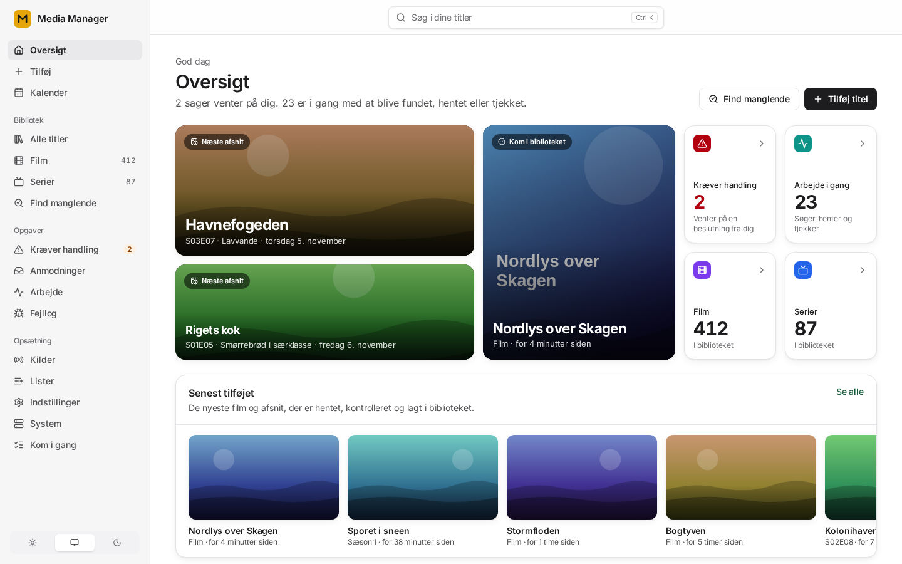
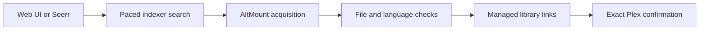
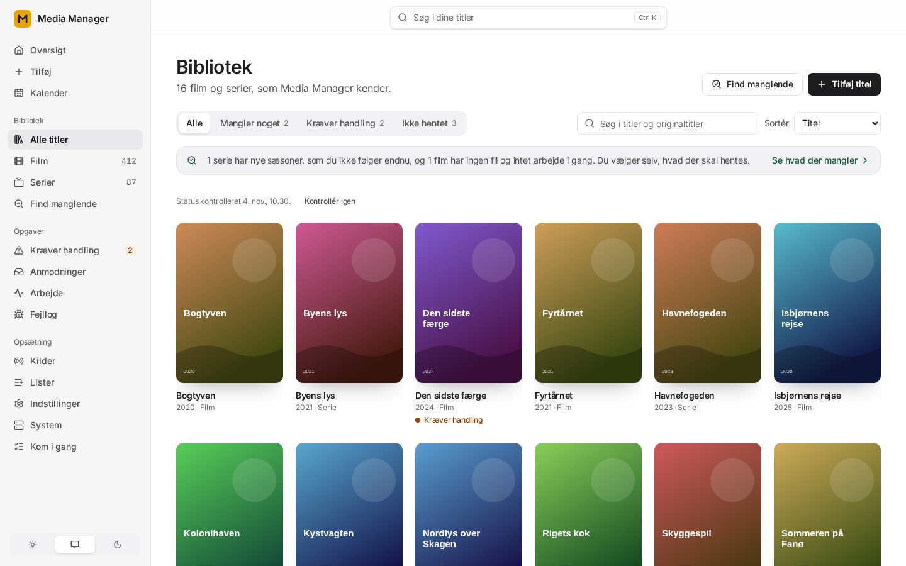
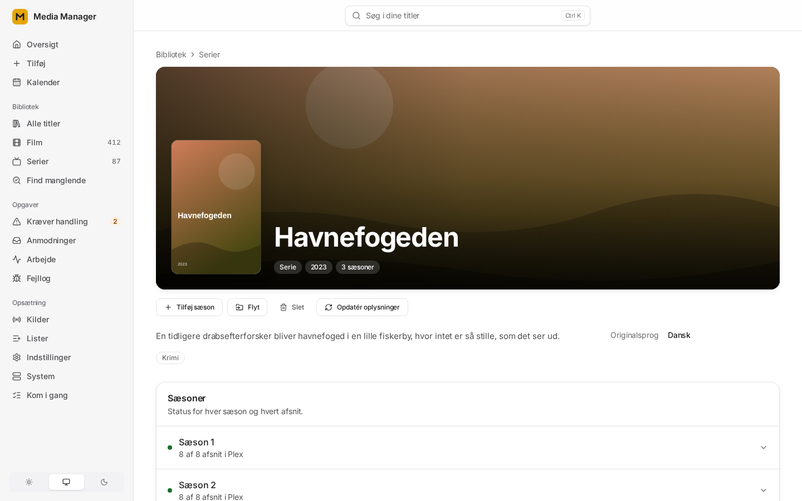
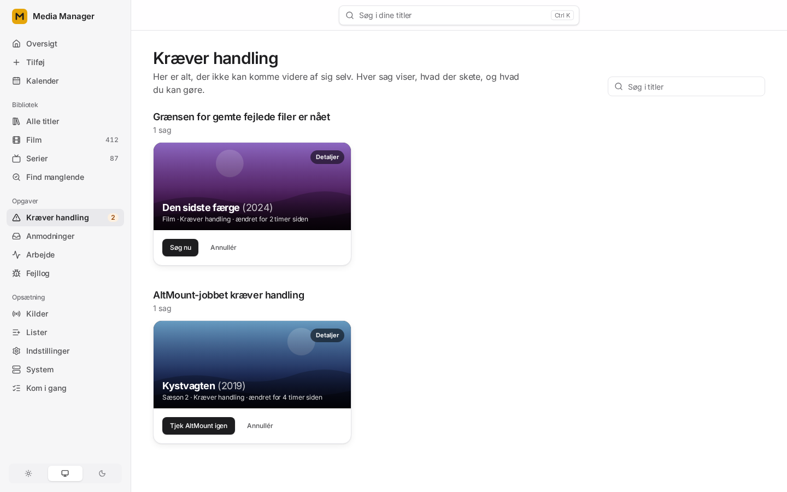
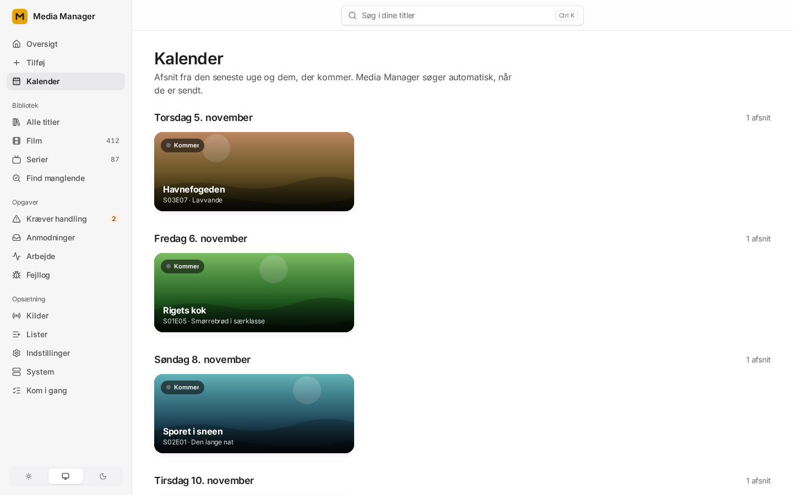

# Media Manager

**Your Usenet requests, verified and ready in Plex.**

Self-hosted movie and TV management with Seerr requests, AltMount acquisition,
and audio and subtitle checks before publication.

**Latest beta: [v0.1.0-beta.37](https://github.com/Media-manager52/Media-manager/releases/tag/v0.1.0-beta.37)**

[Install](#installation) · [Documentation](docs/README.md) · [Releases](https://github.com/Media-manager52/Media-manager/releases) · [Get help](.github/SUPPORT.md)

Beta software · Danish interface · Linux amd64

<picture>
  <source media="(prefers-color-scheme: dark)" srcset="docs/images/overview-dark.png">
  
</picture>

Media Manager brings requests, release selection, verification and library status
into one place. Add a title in the web UI or through [Seerr](https://github.com/seerr-team/seerr);
Media Manager searches your indexers, acquires through [AltMount](https://github.com/javi11/altmount),
checks the actual output and confirms the exact file in Plex.

## What it does

| Feature | Behavior |
| --- | --- |
| **Verifies the actual files** | Checks video, audio and subtitles against your quality and language rules. A release name is never proof. |
| **Protects your library** | Replaces a working version only after Plex confirms the replacement. AltMount output stays read-only; failed output stays available for review. |
| **Handles complete seasons** | Keeps a season pack as one acquisition job and verifies every expected episode before publication. |
| **Respects indexer limits** | Uses persisted pacing, provider quotas, cooldowns and bounded recovery probes. Recent search results are reused only when their scope and evidence remain valid. |
| **Keeps requests moving** | Supports Seerr, MDBList imports, missing-episode discovery and guarded recovery of broken files. Every attempt and owner action remains visible. |
| **Supports Danish libraries** | Verifies required audio or subtitles from the release itself, learns from measured release-group results and includes a native OldBoys adapter. |

An [OpenAPI reference](docs/reference/openapi.json),
[MCP server](docs/operations/ai-agents.md) and scoped streaming API support
automation and separate playback clients. Seerr connects directly through
Media Manager's compatible movie and TV request APIs.

## Installation

Choose the installation path that fits your setup:

| Method | Start here |
| --- | --- |
| **Cosmos market** | [Install through Cosmos Cloud](docs/getting-started.md#install-from-the-cosmos-market), with optional bundled AltMount and Plex. |
| **Published images** | [Install an immutable release image pair](docs/operations/install-release.md), without compiling the application. |
| **From source** | [Build with the setup script](docs/getting-started.md#source-installation) and manage the Compose project yourself. |

The supported stack uses **Linux amd64, Docker Compose, Cosmos Cloud, Plex,
AltMount and a Newznab indexer**. Seerr is optional. See the installation guides
for versions, mounts, credentials and backup requirements.

After installation, connect your services, choose library roots and quality
profiles, then add your first title.
[Dansk kom i gang](docs/onboarding/kom-i-gang.da.md) explains each step in Danish.

## How it works

PostgreSQL stores every workflow and retry so work can resume after a restart.
A successful acquisition becomes available only after the required file checks
and exact Plex confirmation. Read the [workflow guide](docs/architecture/workflows.md)
and [system guarantees](docs/invariants.md) for the full lifecycle.

## Screenshots

| Library | Title and season progress |
| --- | --- |
|  |  |
| **Needs attention** | **Calendar** |
|  |  |

Light and dark themes are included. Screenshots use invented demo titles and
locally drawn artwork; see [how to regenerate them](CONTRIBUTING.md#verification).

## Documentation

| Looking for | Guide |
| --- | --- |
| Installation and first title | [Getting started](docs/getting-started.md) · [Dansk vejledning](docs/onboarding/kom-i-gang.da.md) |
| Configuration, updates and backups | [Operations runbook](docs/operations/runbook.md) · [Manual configuration](docs/operations/manual-install.md) |
| Code, API and architecture | [Developer onboarding](docs/onboarding/README.md) · [API reference](docs/architecture/api.md) |
| Changes and image identities | [Changelog](CHANGELOG.md) · [Release records](docs/README.md#releases) |
| The full documentation set | [Documentation index](docs/README.md) |

The application uses Go, PostgreSQL, React and TypeScript. Vite builds the UI;
Docker Compose runs it behind the Cosmos Cloud authentication layer.

## Contributing and support

Questions and reproducible bugs are welcome. Start with the [support guide](.github/SUPPORT.md)
or read [CONTRIBUTING.md](CONTRIBUTING.md) before opening a pull request.
Report security vulnerabilities through the [private reporting process](SECURITY.md).

Media Manager is in beta. The [release notes](https://github.com/Media-manager52/Media-manager/releases)
describe verification, schema requirements, upgrade instructions and known limitations.

## License

[GNU Affero General Public License v3.0 only](LICENSE) (`AGPL-3.0-only`).
See [third-party notices](THIRD_PARTY_NOTICES.md) for included components.

This product uses the TMDB API but is not endorsed or certified by TMDB.
